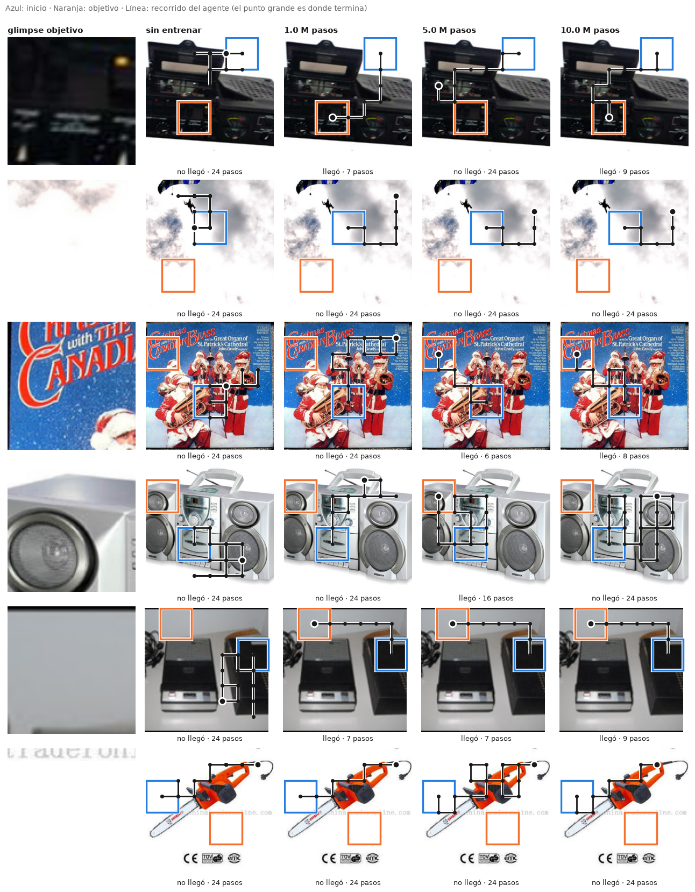
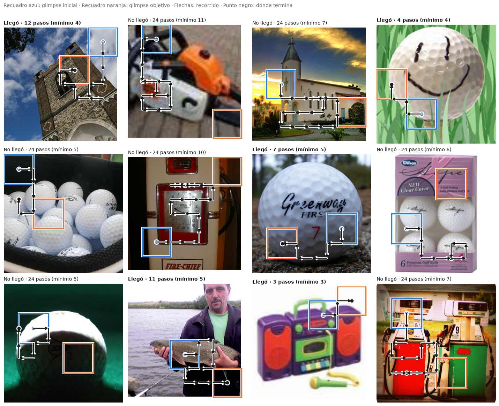

# Bitácora

Registro cronológico de lo que se hace y de los resultados. El plan está en [ROADMAP.md](ROADMAP.md). Cada entrada: qué se hizo, cómo reproducirlo, resultado y qué se decide a partir de él.

## 2026-11-25 — Diseño y revisión de trabajo relacionado

- Definido el diseño (ver "Decisiones tomadas" en el roadmap): glimpses de 112 px con paso de 56 px sobre imágenes de 448 px (rejilla 7×7), DINOv2 ViT-S/14, Imagenette, PPO, fine-tuning solo con RL.
- Revisión de trabajo relacionado: seis búsquedas web y lectura de cinco papers (CanViT, "What Can We Learn from Noise?", AdaGlimpse, GRPO-RM, EVA). Ninguno combina navegación a un glimpse objetivo + fine-tuning de un encoder preentrenado solo con RL + medición del olvido. Detalle en el roadmap.
- Consecuencias para el plan: línea base sin RL (regresión directa del desplazamiento al objetivo) y currículo de distancia al objetivo si el agente no aprende.

## 2026-11-25 — Fase 0: entorno

- Repo privado: https://github.com/jackspolski1103/glimpse-nav-rl
- Entorno con `uv`, Python 3.12, PyTorch 2.15.0 (MPS disponible), timm 1.0.31.
- Modal instalado y autenticado (workspace `jackspolski2000`) para cuando haga falta GPU en la fase 2.
- Código:
  - `glimpse.py`: constantes de la rejilla, extracción de glimpses, carga del encoder. `uv run python glimpse.py` ejecuta su comprobación (49 glimpses por imagen y cada uno coincide con el recorte esperado): **pasa**.
  - `precompute.py`: embeddings de los 49 glimpses por imagen con el encoder congelado → `cache/{train,val}.npz`.
  - `probes.py`: probes sobre los embeddings congelados (posición absoluta, dirección del vecino, desplazamiento entre dos glimpses).
- Velocidad medida en el Mac (MPS): **565 glimpses/s** con DINOv2 ViT-S → unos 20 min para Imagenette completo (13 394 imágenes × 49).

## 2026-11-25 — Decisión: estándares de RL

- Entorno con interfaz de Gymnasium; PPO adaptado de CleanRL (no escrito de cero); Stable-Baselines3 como comprobación cruzada en la fase 1. Motivo: para investigación, la corrección del PPO debe poder defenderse, y la fase 2 necesita control directo del gradiente hacia el encoder.
- Métrica de navegación: tasa de éxito y SPL (Anderson et al., 2018), el estándar en navegación.
- Máscara de visitados **egocéntrica** (13×13 centrada en el agente): así el agente no recibe su posición absoluta.

## 2026-11-25 — Fase 1 (adelantada): entorno y PPO, validados sin datos reales

Hecho mientras se descargaba Imagenette; no depende de los embeddings.

- `env.py`: entorno en tensores (`GlimpseNav`) + envoltura Gymnasium (`GlimpseNavGym`). Episodio de 24 pasos como máximo, +1 al llegar, −0,01 por paso, chocar con el borde = no moverse.
  - `uv run python env.py`: **pasa**. Comprueba que el camino más corto llega siempre en exactamente la distancia Manhattan, que el borde bloquea y que la envoltura Gymnasium termina con éxito.
- `ppo.py`: PPO de CleanRL adaptado al entorno en tensores. 256 entornos × 32 pasos por actualización, MLP 256-256 tanh.
- **Comprobación del PPO** (`uv run python ppo.py --task positions --steps 1000000`, semilla 0): el "embedding" es la posición en one-hot, así que la tarea es resoluble con certeza.

  | | Éxito | SPL |
  |---|---|---|
  | Paseo aleatorio | 23,0 % | 0,096 |
  | PPO, 300 mil pasos | 100,0 % | 0,802 |
  | PPO, 1 millón de pasos | 100,0 % | 0,991 |

  Velocidad: ~36 000 pasos/s en CPU. **Conclusión:** el PPO y el entorno funcionan; el paseo aleatorio (23 %) es el suelo contra el que comparar. Una sola semilla.
- Pendiente de esta fase: correrlo sobre embeddings reales y la comprobación cruzada con Stable-Baselines3.

## 2026-11-25 — Requisito: los embeddings no ven la imagen completa

- Requisito del proyecto: el embedding de un glimpse solo puede depender de los píxeles de ese glimpse. Vale para el glimpse actual y para el objetivo, en todas las fases de entrenamiento.
- Cómo se cumple: `precompute.py` recorta primero y codifica cada recorte como una imagen independiente de 112 px; la atención del ViT solo ocurre entre los 64 parches internos del recorte.
- `uv run python test_no_leak.py`: **pasa**. Cambia todos los píxeles de la imagen salvo los de un glimpse y comprueba que el embedding de ese glimpse no varía (y que los de otros glimpses sí).
- Única excepción, a propósito: el experimento B evalúa el encoder con imagen completa, porque así se evaluó el modelo original. No interviene en ningún entrenamiento.

## 2026-11-25 — Fase 0: embeddings y probes (completada)

- Imagenette descargado: 9 469 imágenes de entrenamiento, 3 925 de validación. (La descarga se cortó una vez; se terminó en 8 tramos paralelos y la descompresión verificó la integridad.)
- `uv run python precompute.py` → `cache/train.npz` (9469×49×384) y `cache/val.npz` (3925×49×384), unos 15 min en el Mac.
- `uv run python probes.py` (entrena en train, evalúa en val; 3000 pasos, semilla 0):

  | Probe | Resultado | Referencia |
  |---|---|---|
  | Posición absoluta desde 1 glimpse (lineal, 49 clases) | 10,9 % | azar 2,0 % |
  | Dirección del vecino desde 2 glimpses (lineal) | 47,2 % | azar 25 % |
  | Dirección del vecino desde 2 glimpses (MLP 512) | 72,9 % | azar 25 % |
  | Desplazamiento entre 2 glimpses cualesquiera (MLP 512) | error 2,92 casillas; exacto 7,4 % | sin información: 4,58 casillas |

- **Lectura:** un glimpse aislado casi no sabe dónde está (lo que se buscaba). Dos glimpses vecinos permiten deducir la dirección mejor que el azar pero lejos del 100 %, y hace falta no linealidad (47 % → 73 %). Para pares lejanos la información es escasa. Ese es el margen que el fine-tuning puede mejorar.
- Limitación: una semilla y probes cortos; los números del MLP pueden subir con más entrenamiento.

## 2026-11-25 — Fase 1: PPO sobre embeddings congelados y comprobación cruzada

Todo en validación, 4096 episodios por evaluación. Paseo aleatorio: 23,0 % de éxito, SPL 0,096.

**Comprobación cruzada con Stable-Baselines3** (`sb3_check.py`; 64 entornos, 2 M de pasos, mismos hiperparámetros, misma función de evaluación):

| Implementación | Semillas 0 / 1 / 2 (éxito %) | Media |
|---|---|---|
| Stable-Baselines3 PPO | 51,6 / 50,0 / 52,1 | 51,2 |
| PPO propio, CleanRL original | 42,9 (solo semilla 0) | — |
| + continuar el valor al agotarse el tiempo | 47,2 / 44,7 / 47,0 | 46,3 |
| + sin recorte de la pérdida de valor (**versión final**) | 49,5 / 50,1 / 47,3 | 49,0 |

- Dos diferencias de implementación explicaban la brecha inicial de ~9 puntos:
  1. **Tiempo agotado:** CleanRL lo trata como estado terminal; lo correcto (Pardo et al., 2018; lo que hace SB3) es continuar con el valor del estado final. `env.py` devuelve ahora la observación terminal y `ppo.py` la usa.
  2. **Recorte de la pérdida de valor:** CleanRL lo aplica por defecto, SB3 no. Ahora está desactivado por defecto (`--clip-vloss` lo reactiva).
- Quedan ~2 puntos de diferencia en la media, con rangos que casi se tocan (47,3–50,1 frente a 50,0–52,1). Con 3 semillas no se puede afirmar que sea cero; se da la implementación por validada para la fase 1 y se anota como diferencia residual.
- En la tarea de control (posiciones dadas) ambas implementaciones llegan al 100 %.

**Entrenamiento largo, versión final** (`uv run python ppo.py --task embeddings --steps 10000000 --evals 20 --name frozen_s0`; 256 entornos, semilla 0, ~7 min en CPU):

| | Éxito (val) | Éxito (train) | SPL (val) |
|---|---|---|---|
| Sin entrenar | 22,7 % | 23,4 % | 0,098 |
| 2 M de pasos | ~54 % | ~55 % | ~0,35 |
| 10 M de pasos | **60,3 %** | 61,4 % | **0,404** |

La curva sube rápido hasta ~55 % en 2 M de pasos y después muy despacio: se acerca a un techo. **Esta es la línea base del experimento A** (encoder original congelado). Una sola semilla.

**Ejemplos sobre validación** (`uv run python viz.py --name frozen_s0`): seis imágenes de validación, mismo inicio y objetivo, con el agente sin entrenar y tras 1, 5 y 10 M de pasos. La política es estocástica, así que cada recorrido es una muestra.

Observaciones sobre estos seis casos (anecdóticas, no medidas):
- Sin entrenar, el agente deambula cerca del inicio; entrenado, va hacia el objetivo cuando este tiene contenido distintivo (panel del equipo, letras de la carátula, pared gris junto al borde).
- Los fallos se concentran en objetivos sin contenido propio (cielo blanco, fondo blanco): desde el embedding no hay forma de saber dónde está ese recorte. En esos casos el agente termina pegado a un borde.
- Pendiente de medir: éxito según la distancia inicial al objetivo y según lo "informativo" que sea el glimpse objetivo.

**Más ejemplos** (agente final, 12 imágenes de validación por figura, con flechas de recorrido): llegó en 9 de 12 y en 5 de 12.

**Sin sobreajuste:** el éxito en imágenes de entrenamiento es prácticamente igual al de validación en todas las corridas. El techo no es memorización sino lo que el embedding congelado permite deducir.

## 2026-11-25 — Fase 1: ¿dónde falla el agente? (línea base `frozen_s0`)

`uv run python analysis.py --name frozen_s0` (50 000 episodios de validación, éxito global 60,7 %):

| Distancia inicial (casillas) | Éxito |
|---|---|
| 1–2 | 68,6 % |
| 3–4 | 64,1 % |
| 5–6 | 59,0 % |
| 7–8 | 52,8 % |
| 9–12 | 44,5 % |

- **Incluso a 1–2 casillas falla un 31 %**, pese a que el objetivo se solapa con lo que ve. Coincide con el probe de dirección del vecino (73 %): el embedding congelado no deja deducir bien la dirección.
- **La hipótesis "falla cuando el objetivo es ambiguo" no se confirma.** Midiendo la ambigüedad como la similitud máxima del objetivo con otras casillas de la imagen, el éxito por cuartiles es 55,9 / 63,8 / 65,2 / 57,8 %: no hay tendencia. (La medida es imperfecta: con solape, la casilla más parecida suele ser una vecina.)

**Hallazgo: el agente se queda atascado contra el borde.** Al chocar, la observación no cambia, así que repite la acción.

| | En episodios fallidos | En episodios con éxito |
|---|---|---|
| Pasos gastados chocando con el borde | 51,4 % | 7,5 % |

- El 72,1 % de los fallos incluye una racha de ≥5 choques seguidos; el 56,2 %, de ≥10.
- Es un defecto del entorno, no del embedding: el agente no tiene forma de percibir el borde.

**Prueba de dos remedios** (`--walls`, 2 M de pasos, 256 entornos, semilla 0):

| Observación | Éxito (val) | SPL |
|---|---|---|
| Sin información de borde (actual) | 54,2 % | 0,357 |
| `bump`: dirección del último movimiento bloqueado | 59,3 % | 0,391 |
| `sensor`: hay borde arriba/abajo/izquierda/derecha | 64,4 % | 0,431 |

- `sensor` rinde más, pero revela posición parcial (24 de las 49 casillas tocan un borde). `bump` solo informa después de chocar.
- Decisión pendiente del usuario. Una semilla por variante.

## 2026-11-25 — Fase 1: el techo viene del embedding, no del tamaño de la red

- **Política 4 veces más ancha** (`--hidden 1024`, 3 M de pasos, semilla 0): 58,4 % de éxito, SPL 0,368. Con 256 unidades, a los mismos pasos, la corrida larga daba ~56–57 %. Diferencia de 1–2 puntos: ampliar la política no rompe el techo.
- **Probes con casi 7 veces más entrenamiento** (`probes.py --steps 20000`): dirección del vecino con MLP 74,5 % (antes 72,9 %); lineal 47,1 %; posición absoluta 10,6 %. Prácticamente saturados.
- **Conclusión:** ni más capacidad ni más entrenamiento de la cabeza mejoran de forma apreciable. Lo que limita es la información de dirección disponible en el embedding congelado (más el atasco en el borde, ver entrada anterior). Se mantiene la política pequeña (256-256).

## 2026-11-25 — Decisión: aviso de choque, y nueva línea base (experimento A, encoder original)

- Decisión del usuario: el agente percibe el borde con un **aviso de choque** (4 valores: dirección del último movimiento si el borde lo bloqueó). No revela la posición sin actuar. Es el valor por defecto en `env.py`; `--walls none|sensor` quedan para ablación.
- Línea base definitiva del encoder original congelado (`ppo.py --task embeddings --steps 10000000 --evals 20 --seed S --name frozen_bump_sS`; 256 entornos):

  | Semilla | Éxito (val) | Éxito (train) | SPL (val) |
  |---|---|---|---|
  | 0 | 71,2 % | 72,9 % | 0,473 |
  | 1 | 72,3 % | 73,1 % | 0,473 |
  | 2 | 71,0 % | 71,2 % | 0,460 |
  | **Media** | **71,5 %** | 72,4 % | **0,469** |

  Paseo aleatorio: 23 %, SPL 0,10. Sin aviso de choque la misma configuración daba 60,3 % (una semilla).
- Las tres semillas quedan a ~1 punto entre sí: diferencias de más de 2–3 puntos entre encoders serán interpretables.
- `analysis.py --name frozen_bump_s0` (50 000 episodios, éxito 71,4 %): por distancia inicial 77,7 / 73,7 / 70,2 / 66,8 / 54,9 % (1–2, 3–4, 5–6, 7–8, 9–12 casillas). Sigue fallando un 22 % a 1–2 casillas: ese es el margen atribuible al embedding.
- Figuras: `figures/frozen_bump_s0_curva.png`, `_trayectorias.png`, `_ejemplos_1.png` (llegó en 10 de 12), `_ejemplos_2.png` (8 de 12).

## 2026-11-25 — Fase 2: implementación del fine-tuning con RL

- `ppo.py`: el entrenador admite un encoder en vivo (`live`). En el rollout se guardan los tokens a la salida del tronco congelado; en la actualización se recalcula el embedding del glimpse actual con gradiente, así la pérdida de PPO llega a los bloques liberados. El camino con encoder congelado no cambia (la tarea de control sigue llegando al 100 %).
- `finetune.py`: etapa 1 (cabeza del agente, encoder congelado, 2 M de pasos) → etapa 2 (últimos `k` bloques + norma final liberados, LR propio). El glimpse objetivo siempre sale del encoder original congelado. Registra `x_cos`: similitud coseno entre el embedding ajustado y el original en glimpses de validación (deriva).
- `uv run python test_finetune.py`: **pasa**. (1) tronco + cola reproduce el encoder completo; (2) el recorte en el dispositivo da los mismos embeddings que la fase 0 (coseno mínimo 1,00000); (3) el gradiente llega solo a los bloques liberados (3,55 M de 22,06 M parámetros con k=2).
- Prueba de punta a punta en el Mac (32 imágenes, pocos pasos): corre completa. Velocidad de la etapa 2 en MPS: **~87 pasos/s** → 10 M de pasos serían ~32 h. Por eso la fase 2 corre en Modal.
- `modal_app.py`: prepara los datos en un Volume de Modal y lanza corridas en GPU A10.

## 2026-11-26 — Fase 2: fine-tuning con RL en Modal (tres intensidades)

**Lanzamiento.** `uv run modal run --detach modal_app.py --runs "ft_k2_lr1e-5:--k 2 --lr-enc 1e-5 --s2 6000000 --evals 12"` (y lo mismo con `3e-6` y `3e-5`). GPU A10, etapa 1 de 2 M de pasos (encoder congelado) + etapa 2 de 6 M (últimos 2 bloques + norma final liberados), semilla 0, precisión mixta (bfloat16).

**Problemas hasta que arrancó** (cuatro intentos):
1. Sin memoria en GPU al recortar glimpses: los índices del recorte sobre el tensor completo de píxeles ocupan varios GB. Arreglo: recortar por tandas de 512 y seleccionar primero las imágenes.
2. Sin memoria otra vez, en el cálculo de embeddings de todo el dataset. Causa real: el token CLS es una *vista* del tensor de todos los tokens; guardarlo sin copiar retenía 156 MB por tanda. Arreglo: `.clone()`. En el Mac no se veía porque allí se copiaba a memoria normal.
3. Un script de diagnóstico con una importación inexistente en el contenedor quedó reintentando ~10 min antes de detenerlo.
- Medido en la A10: 2 800 glimpses/s en precisión normal, 9 000 con precisión mixta. Etapa 2: ~2 050 pasos/s (en el Mac, 87).

**Resultados durante el entrenamiento** (éxito en validación; `x_cos` = similitud coseno entre el embedding ajustado y el original en glimpses de validación):

| Pasos totales | Congelado (3 semillas) | LR 3e-6 | LR 1e-5 | LR 3e-5 |
|---|---|---|---|---|
| 2 M (inicio etapa 2) | 61,0 % | 60,4 % | 60,4 % | 60,4 % |
| 4 M | 66,5 % | 65,4 % | 67,9 % | 65,5 % |
| 6 M | 69,3 % | 69,2 % | 71,6 % | 70,9 % |
| 8 M (final) | 71,2 % | 70,9 % | 73,5 % | **76,0 %** |
| `x_cos` final | 1,00 | 0,91 | 0,79 | 0,51 |
| SPL final | ~0,47 | 0,468 | 0,489 | 0,514 |

- En la primera mitad ninguna corrida superaba al encoder congelado; en la segunda, las de LR más alto se despegan: +2,3 puntos (1e-5) y +4,8 puntos (3e-5) a los mismos pasos totales. La de 3e-5 seguía subiendo al cortar.
- Cuanto mayor el LR, más se aleja el encoder del original (similitud 0,91 → 0,79 → 0,51).
- Entrenamiento y validación terminan parejos en las tres (diferencias ≤1 punto al final): no hay señal clara de memorización.
- Limitaciones: una semilla por LR; los calendarios de LR no son idénticos a los de la línea base (el del agente se reinicia en la etapa 2). **Esta comparación es preliminar: la válida es el experimento A.**

**Gasto en Modal:** 4,09 USD medidos en total (0,34 de los intentos fallidos y el diagnóstico; ~3,75 de las tres corridas de ~50 min). Facturado: 0,00 USD (cubierto por créditos). Tope fijado por el usuario: 15 USD.

## 2026-11-26 — Experimentos A y B en Modal

**Cambio de plan de cómputo.** El primer intento fue en el Mac (seis agentes en paralelo más la evaluación B) y el sistema los cortó por falta de memoria; no se salvó nada. Por indicación del usuario, lo pesado pasa a Modal: `uv run modal run --detach modal_app.py::experiments` (funciones `exp_a` y `exp_b` en `modal_app.py`). Resultados en `results/modal/`.

**Experimento A — ¿navega mejor?** Agente nuevo desde cero sobre cada encoder congelado (tablas de embeddings), 10 M de pasos, 3 semillas, mismos hiperparámetros. Solo CPU en Modal (4 núcleos, ~4 500 pasos/s, ~37 min por corrida).

| Encoder | Éxito val. por semilla | Media ± desv. | SPL | Éxito train |
|---|---|---|---|---|
| Original | 71,3 / 73,1 / 71,2 | 71,9 ± 1,1 % | 0,470 | 72,4 % |
| Ajustado LR 3e-6 | 74,9 / 75,7 / 74,4 | 75,0 ± 0,6 % | 0,517 | 76,1 % |
| Ajustado LR 1e-5 | 78,8 / 79,7 / 80,5 | 79,7 ± 0,8 % | 0,565 | 81,0 % |
| Ajustado LR 3e-5 | 80,7 / 81,1 / 80,9 | **80,9 ± 0,2 %** | 0,595 | 82,2 % |

- El encoder ajustado con RL navega mejor: +3,1, +7,8 y +9,0 puntos de éxito. Las diferencias son varias veces la dispersión entre semillas.
- La ventaja aparece desde el principio del entrenamiento del agente nuevo (a 5 M de pasos: 67 / 72 / 76 / 79 %), no solo al final.
- La mejora es mayor que la vista durante el fine-tuning (76,0 % con LR 3e-5). Diferencia a tener en cuenta: aquí el glimpse objetivo también se codifica con el encoder ajustado; durante el fine-tuning venía del original.
- Entrenamiento y validación difieren ~1 punto: no hay memorización de imágenes.

**Experimento B — ¿qué perdió?** Imagen completa a 224 px, encoder congelado, k-NN (k=20) sobre el token CLS; similitud con el encoder original sobre las mismas imágenes de validación. GPU A10 en Modal.

| Encoder | k-NN Imagenette | k-NN Imagewoof | Coseno (Imagewoof) | CKA (Imagewoof) |
|---|---|---|---|---|
| Original | 99,54 % | 95,27 % | 1,00 | 1,00 |
| Ajustado LR 3e-6 | 99,39 % | 95,27 % | 0,90 | 0,98 |
| Ajustado LR 1e-5 | 99,29 % | 94,96 % | 0,75 | 0,93 |
| Ajustado LR 3e-5 | 98,24 % | 91,70 % | 0,42 | 0,74 |

- LR 3e-6 y 1e-5 casi no pierden (0 y −0,3 puntos en Imagewoof); LR 3e-5 pierde 3,6 puntos.
- **Mejor compromiso: LR 1e-5** — +7,8 puntos de navegación por −0,3 de k-NN. Pasar a 3e-5 da solo +1,2 de navegación y cuesta 3,3 más de k-NN.
- Imagewoof no se usó en el ajuste, pero son clases de ImageNet, que DINOv2 sí vio; es una medida de olvido, no de generalización a datos nuevos.

Figura: `figures/expAB.png` (`fig_ab.py`).

**Limitaciones.** Un solo fine-tuning por LR (las 3 semillas son del agente nuevo, no del ajuste). Falta la línea base sin RL (regresión directa del desplazamiento), que es la objeción principal. k-NN de clasificación es una sola medida de "información general"; falta segmentación (Pascal VOC).

**Gasto en Modal:** 5,33 USD medidos en total (esta tanda: ~1,3 USD). Facturado: 0,00 USD. Tope: 15 USD.

## 2026-11-26 — ¿El agente va hacia el objetivo o recorre la imagen?

Pregunta del usuario. Medido con el agente del encoder congelado (`frozen_bump_s0`, 20 000 episodios de validación, una semilla):

| Condición | Éxito | Primer paso acerca | Pasos que acercan (todos) |
|---|---|---|---|
| Agente normal | 71,8 % | 76,7 % | 53,0 % |
| Mismo agente, objetivo cambiado por el de otra imagen | 28,8 % | 54,4 % | 34,7 % |
| Paseo aleatorio | 23,0 % | 43,4 % | 42,9 % |

- Usa el objetivo: sin el objetivo correcto cae casi al azar. Además, un barrido ciego tiene un techo del 50 % (24 pasos, 48 casillas posibles).
- Se orienta bien al arrancar y después es menos fino: camino ≈1,5 veces el más corto en los episodios exitosos.

## 2026-11-26 — Línea base sin RL: regresión directa del desplazamiento

**Qué es.** `regress.py`: mismos bloques libres (k=2), mismos LR, mismos 6 M de glimpses nuevos en tandas de 8192 reutilizadas 4 épocas × 4 minilotes, mismo decaimiento y recorte de gradiente que la etapa 2 con RL. En vez de agente y recompensa, una cabeza MLP predice (Δfila, Δcolumna) al objetivo; el objetivo viene del encoder original congelado. Pares (actual, objetivo) uniformes. Calentamiento de la cabeza: 2 000 pasos con el encoder congelado.

Lanzamiento: `uv run modal run --detach modal_app.py::main --module regress --runs "reg_k2_lr1e-5:--k 2 --lr-enc 1e-5;..."` y luego `modal_app.py::experiments --encs reg_k2_lr3e-6,reg_k2_lr1e-5,reg_k2_lr3e-5 --tag _reg`. A10, 37 min por ajuste.

**Durante el ajuste.** Error de desplazamiento (L1, casillas, validación): 3,17 → 2,87 / 2,87 / 2,94 (LR 3e-6 / 1e-5 / 3e-5). Baja poco.

**Experimentos A y B, RL frente a regresión** (A: 3 semillas del agente nuevo, 10 M de pasos; B: k-NN con imagen completa):

| Ajuste | LR | Éxito val. | Éxito train | SPL | k-NN Imagenette | k-NN Imagewoof | CKA Imagewoof |
|---|---|---|---|---|---|---|---|
| Ninguno (original) | — | 71,9 ± 1,1 % | 72,4 % | 0,470 | 99,54 % | 95,27 % | 1,00 |
| RL | 3e-6 | 75,0 ± 0,6 % | 76,1 % | 0,517 | 99,39 % | 95,27 % | 0,98 |
| RL | 1e-5 | 79,7 ± 0,8 % | 81,0 % | 0,565 | 99,29 % | 94,96 % | 0,93 |
| RL | 3e-5 | **80,9 ± 0,2 %** | 82,2 % | 0,595 | 98,24 % | 91,70 % | 0,74 |
| Regresión | 3e-6 | 79,2 ± 0,5 % | 80,5 % | 0,566 | 99,19 % | 93,87 % | 0,89 |
| Regresión | 1e-5 | 77,8 ± 0,5 % | 83,4 % | 0,565 | 98,88 % | 91,73 % | 0,74 |
| Regresión | 3e-5 | 76,1 ± 0,9 % | 90,5 % | 0,563 | 98,32 % | 85,57 % | 0,53 |

- **La regresión también mejora la navegación** (+4 a +7 puntos sobre el original): buena parte de la ganancia viene de la señal de posición, no del RL en sí.
- **A igual navegación, RL olvida menos.** Cerca del 79–80 % de éxito: RL (1e-5) pierde 0,3 puntos de k-NN en Imagewoof; regresión (3e-6) pierde 1,4. A igual LR la regresión siempre olvida más (hasta −9,7 puntos con 3e-5).
- **La regresión empeora al subir el LR y memoriza:** con 3e-5 el éxito en entrenamiento es 90,5 % y en validación 76,1 %. Con RL la diferencia train–val nunca pasa de 1,3 puntos.
- **El mejor resultado de navegación es de RL** (80,9 % frente a 79,2 %), pero la diferencia es pequeña (1,7 puntos).
- Con LR bajo la regresión rinde más que RL (79,2 % frente a 75,0 % con 3e-6): su señal es más densa.

**Limitaciones.** Un ajuste por celda de la tabla. No probé LR menores que 3e-6 en la regresión, donde podría olvidar menos manteniendo la navegación; la frontera de la regresión no está completa por ese lado. Los pares de la regresión son uniformes y los del RL siguen la distribución de la política. Falta una medida densa (segmentación) en B.

Figura actualizada: `figures/expAB.png`.

**Gasto en Modal:** 8,96 USD medidos en total (esta tanda: ~3,6 USD). Facturado: 0,00 USD. Tope: 15 USD.

## 2026-11-26 — Regresión con LR más bajos (1e-6 y 3e-7)

**Por qué.** En la tanda anterior el mejor punto de la regresión era el LR más bajo probado (3e-6); faltaba ver si con menos LR olvidaba menos sin perder navegación.

Durante el ajuste: error 3,17 → 2,89 (1e-6) y 2,93 (3e-7) casillas; `x_cos` 0,91 y 0,95.

**Frontera completa** (A: 3 semillas, 10 M de pasos; B: k-NN Imagewoof con imagen completa):

| Ajuste | LR | Éxito val. | Éxito train | SPL | k-NN Imagewoof | CKA Imagewoof |
|---|---|---|---|---|---|---|
| Original | — | 71,9 ± 1,1 % | 72,4 % | 0,470 | 95,27 % | 1,00 |
| Regresión | 3e-7 | 76,9 ± 0,5 % | 77,2 % | 0,530 | 95,22 % | 0,98 |
| Regresión | 1e-6 | 77,7 ± 0,8 % | 78,5 % | 0,546 | 94,78 % | 0,95 |
| Regresión | 3e-6 | 79,2 ± 0,5 % | 80,5 % | 0,566 | 93,87 % | 0,89 |
| Regresión | 1e-5 | 77,8 ± 0,5 % | 83,4 % | 0,565 | 91,73 % | 0,74 |
| Regresión | 3e-5 | 76,1 ± 0,9 % | 90,5 % | 0,563 | 85,57 % | 0,53 |
| RL | 3e-6 | 75,0 ± 0,6 % | 76,1 % | 0,517 | 95,27 % | 0,98 |
| RL | 1e-5 | 79,7 ± 0,8 % | 81,0 % | 0,565 | 94,96 % | 0,93 |
| RL | 3e-5 | 80,9 ± 0,2 % | 82,2 % | 0,595 | 91,70 % | 0,74 |

- **Las fronteras se cruzan; ninguno domina.** Sin pérdida apreciable de k-NN (~95,2 %), la regresión navega mejor (76,9 % frente a 75,0 % de RL). Con una pérdida pequeña (~0,3–0,5 puntos), RL navega mejor (79,7 % frente a 77,7 %). El máximo de navegación es de RL (80,9 % frente a 79,2 %).
- La regresión tiene un óptimo en LR 3e-6: por debajo ajusta poco, por encima memoriza y olvida. RL sigue mejorando hasta el LR más alto probado.
- Las diferencias entre métodos son de ~2 puntos con un solo ajuste por punto: **no alcanza para afirmar que RL es mejor que la regresión**. Sí alcanza para decir que ambos mejoran al original (+5 a +9 puntos) y que RL no memoriza al subir el LR.

Incidente: la cadena de espera local se quedó congelada (probable suspensión del Mac) y los experimentos se lanzaron a mano 30 min tarde. Sin pérdida de datos.

Figura actualizada: `figures/expAB.png`.

**Gasto en Modal:** 11,28 USD medidos en total (esta tanda: ~2,3 USD). Facturado: 0,00 USD. Tope: 15 USD; quedan ~3,7.

## 2026-11-26 — Qué cambió en el encoder (sondas) y transferencia a otra disposición

Todo en Modal, orquestado allí (`uv run modal run --detach modal_app.py::run_transfer`). Resultados: `results/modal/probes.json`, `probes_z0.json`, `expA_z0_*.jsonl`.

**Sondas de la fase 0 sobre cada encoder** (misma rejilla del ajuste; entrenadas en train, medidas en val; una semilla):

| Encoder | Posición absoluta (azar 2 %) | Dirección del vecino, lineal | Dirección del vecino, MLP | Error de desplazamiento (casillas) |
|---|---|---|---|---|
| Original | 10,7 % | 46,7 % | 73,2 % | 2,91 |
| RL 3e-6 | 11,2 % | 49,5 % | 74,3 % | 2,83 |
| RL 1e-5 | 11,2 % | 51,5 % | 74,9 % | 2,78 |
| RL 3e-5 | 11,3 % | 52,1 % | 74,8 % | 2,77 |
| Regresión 3e-7 | 11,4 % | 49,7 % | 75,1 % | 2,80 |
| Regresión 1e-6 | 11,7 % | 51,9 % | 76,0 % | 2,74 |
| Regresión 3e-6 | 12,0 % | 53,1 % | 76,5 % | 2,70 |
| Regresión 1e-5 | 12,1 % | 53,8 % | 74,5 % | 2,68 |
| Regresión 3e-5 | 11,8 % | 52,7 % | 70,8 % | 2,75 |

- La información relativa mejora poco pero de forma consistente con el LR: +5 puntos en la sonda lineal de dirección, +1,6 en la MLP, −0,13 casillas de error (RL 1e-5). La posición absoluta casi no cambia: el ajuste no mete "dónde estoy en la imagen" en el embedding.
- La ganancia es mayor en la sonda lineal que en la MLP: el ajuste hace la información más accesible más que añadir información nueva.
- La mejora en las sondas es pequeña comparada con los +8 puntos de navegación: las sondas de un paso no capturan lo que el agente aprovecha en episodios largos.

**Transferencia: glimpses sin solape.** Imagen a 784 px, rejilla 7×7 de glimpses de 112 px sin solape (zoom 1,75×). Ningún encoder se ajustó con esta disposición. Agente nuevo, 5 M de pasos, 2 semillas.

| Encoder | Éxito val. (2 semillas) | SPL | Dirección del vecino, MLP |
|---|---|---|---|
| Original | 57,9 / 56,2 % (57,1) | 0,333 | 62,1 % |
| RL 1e-5 | 63,3 / 65,3 % (64,3) | 0,396 | 63,6 % |
| Regresión 3e-6 | 62,7 / 63,4 % (63,1) | 0,390 | 64,5 % |

- **La mejora se transfiere:** +7,2 puntos (RL) y +6,0 (regresión) en una disposición no vista y sin solape. No es un atajo de casar bordes solapados, que era uno de los riesgos anotados en el roadmap.
- La tarea sin solape es más difícil para todos (57 % frente a 72 % del original).
- RL y regresión vuelven a quedar a ~1 punto, dentro del ruido de 2 semillas.

**Figura antes/después:** `figures/antes_despues.png` (`fig_antes_despues.py`). Seis episodios de validación al azar, idénticos para el encoder original (agente `frozen_bump_s0`) y el ajustado con RL 3e-5 (agente del propio ajuste). En 5 000 episodios idénticos: 70,7 % frente a 74,9 %.

**Gasto en Modal:** 12,24 USD medidos en total (esta tanda: ~1,0 USD). Facturado: 0,00 USD. Quedan ~2,8 del tope.

## 2026-11-26 — Figura antes/después rehecha

El usuario señaló que en la primera versión no se veía mejora. Causas: seis episodios al azar no pueden mostrar una diferencia de 4 puntos, y el "después" usaba el agente del propio ajuste (74,9 %) en vez del agente nuevo del experimento A. Arreglo: `exp_a` ahora guarda el agente final (`out/expA_<enc>_s<seed>_agent.pt`); se repitió una corrida (RL 3e-5, semilla 0).

Sobre 5 000 episodios idénticos de validación (original `frozen_bump_s0` frente a ajustado RL 3e-5):

- Éxito: 70,7 % frente a 79,8 %.
- Llegan los dos 62,8 % · solo el ajustado 16,9 % · solo el original 7,9 % · ninguno 12,3 %.
- Cuando llegan los dos, pasos de más sobre el camino mínimo: 4,18 frente a 2,86.
- La ventaja se mantiene en todas las distancias iniciales y es mayor en las largas (9–12 casillas: 61 % frente a 74 %).

Figuras: `figures/antes_despues.png` (resumen) y `figures/antes_despues_ejemplos.png` (ejemplos de cada caso, los primeros que salieron, no elegidos a mano). La mejora es estadística: no se aprecia en una imagen suelta.
