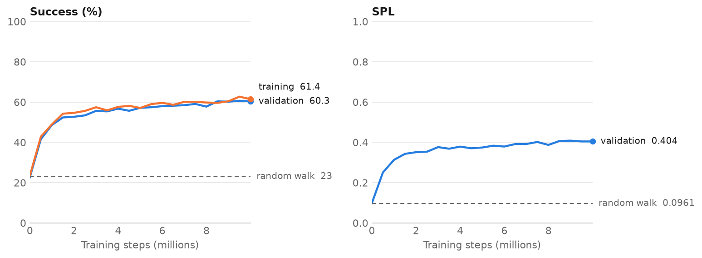
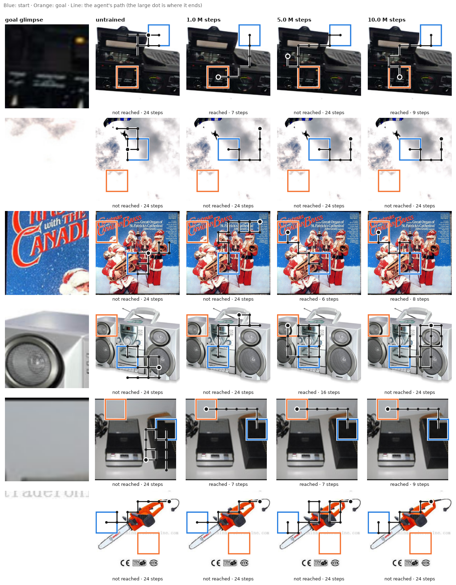
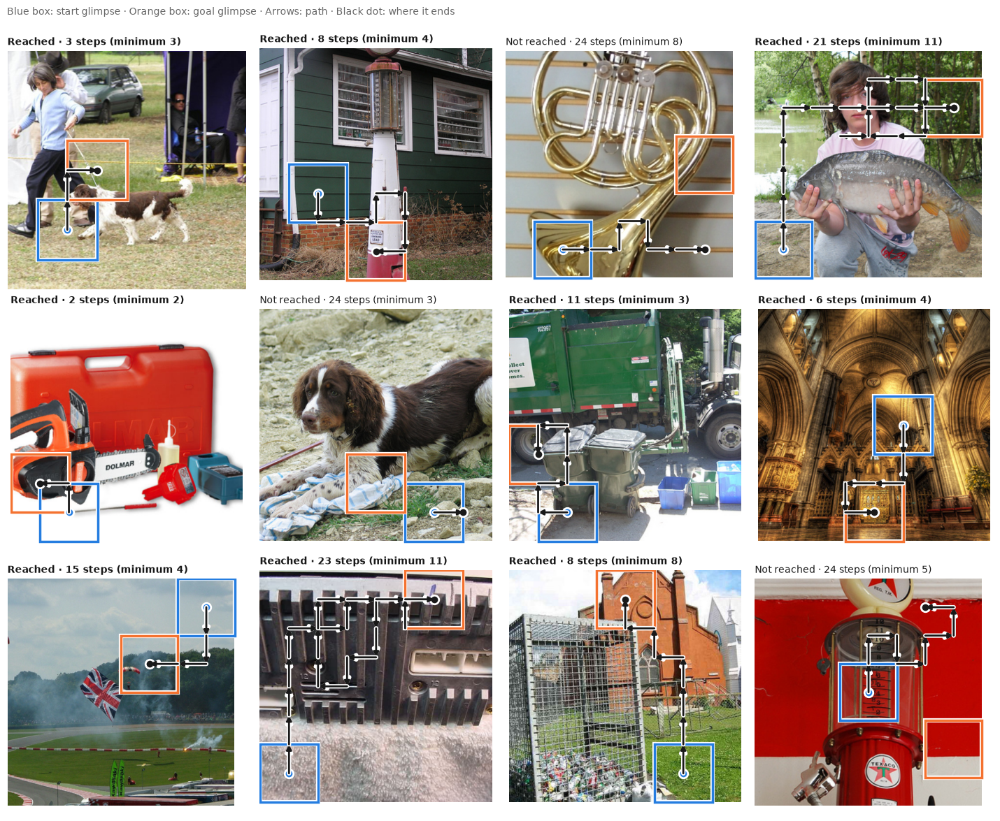
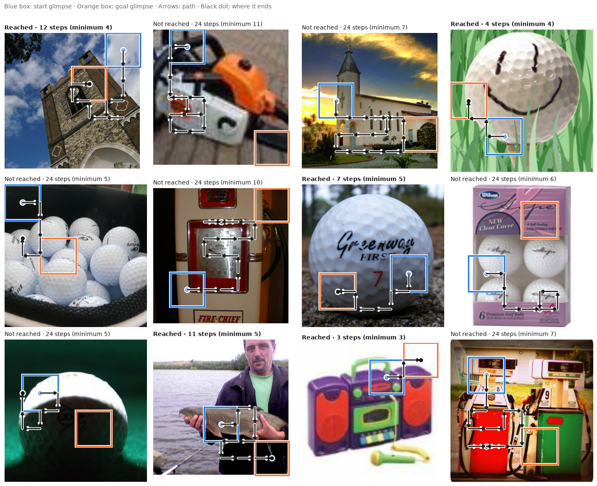
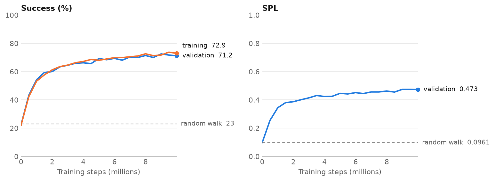
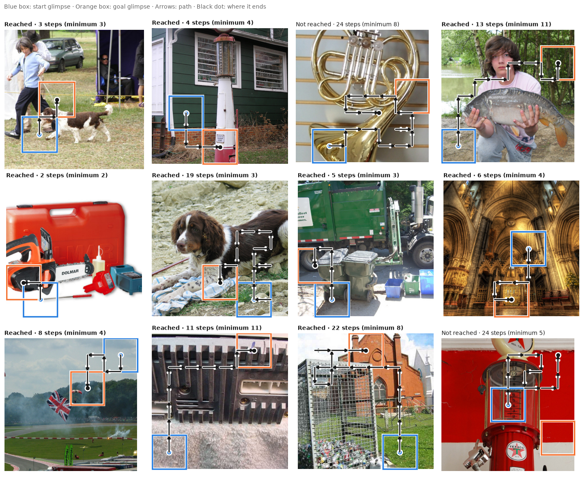

# Log

Chronological record of what is done and of the results. The plan is in [ROADMAP.md](ROADMAP.md). Each entry: what was done, how to reproduce it, the result, and what is decided from it.

## 2026-11-25 — Design and related-work review

- Design defined (see "Decisions made" in the roadmap): 112 px glimpses with a 56 px stride over 448 px images (7×7 grid), DINOv2 ViT-S/14, Imagenette, PPO, fine-tuning with RL only.
- Related-work review: six web searches and five papers read (CanViT, "What Can We Learn from Noise?", AdaGlimpse, GRPO-RM, EVA). None combines navigation to a target glimpse + fine-tuning a pretrained encoder with RL only + measuring forgetting. Details in the roadmap.
- Consequences for the plan: a baseline without RL (direct regression of the offset to the target) and a curriculum over distance to the target if the agent does not learn.

## 2026-11-25 — Phase 0: environment

- Private repo: https://github.com/jackspolski1103/glimpse-nav-rl
- Environment with `uv`, Python 3.12, PyTorch 2.15.0 (MPS available), timm 1.0.31.
- Modal installed and authenticated (workspace `jackspolski2000`) for when a GPU is needed in phase 2.
- Code:
  - `glimpse.py`: grid constants, glimpse extraction, encoder loading. `uv run python glimpse.py` runs its check (49 glimpses per image and each one matches the expected crop): **passes**.
  - `precompute.py`: embeddings of the 49 glimpses per image with the frozen encoder → `cache/{train,val}.npz`.
  - `probes.py`: probes on the frozen embeddings (absolute position, neighbour direction, offset between two glimpses).
- Speed measured on the Mac (MPS): **565 glimpses/s** with DINOv2 ViT-S → about 20 min for the full Imagenette (13,394 images × 49).

## 2026-11-25 — Decision: RL standards

- Environment with the Gymnasium interface; PPO adapted from CleanRL (not written from scratch); Stable-Baselines3 as a cross-check in phase 1. Reason: for research, the correctness of the PPO must be defensible, and phase 2 needs direct control of the gradient into the encoder.
- Navigation metric: success rate and SPL (Anderson et al., 2018), the standard in navigation.
- **Egocentric** visited mask (13×13 centred on the agent): this way the agent does not receive its absolute position.

## 2026-11-25 — Phase 1 (brought forward): environment and PPO, validated without real data

Done while Imagenette was downloading; it does not depend on the embeddings.

- `env.py`: tensor-based environment (`GlimpseNav`) + Gymnasium wrapper (`GlimpseNavGym`). Episode of at most 24 steps, +1 on arrival, −0.01 per step, hitting the border = not moving.
  - `uv run python env.py`: **passes**. Checks that the shortest path always arrives in exactly the Manhattan distance, that the border blocks, and that the Gymnasium wrapper terminates with success.
- `ppo.py`: CleanRL's PPO adapted to the tensor-based environment. 256 environments × 32 steps per update, 256-256 tanh MLP.
- **PPO check** (`uv run python ppo.py --task positions --steps 1000000`, seed 0): the "embedding" is the one-hot position, so the task is solvable with certainty.

  | | Success | SPL |
  |---|---|---|
  | Random walk | 23.0 % | 0.096 |
  | PPO, 300k steps | 100.0 % | 0.802 |
  | PPO, 1 million steps | 100.0 % | 0.991 |

  Speed: ~36,000 steps/s on CPU. **Conclusion:** the PPO and the environment work; the random walk (23 %) is the floor to compare against. A single seed.
- Still pending in this phase: running it on real embeddings and the cross-check with Stable-Baselines3.

## 2026-11-25 — Requirement: the embeddings do not see the full image

- Project requirement: the embedding of a glimpse may depend only on the pixels of that glimpse. This holds for the current glimpse and for the target, in every training phase.
- How it is met: `precompute.py` crops first and encodes each crop as an independent 112 px image; the ViT's attention only happens among the 64 patches inside the crop.
- `uv run python test_no_leak.py`: **passes**. It changes every pixel of the image except those of one glimpse and checks that the embedding of that glimpse does not change (and that those of other glimpses do).
- Only exception, on purpose: experiment B evaluates the encoder on the full image, because that is how the original model was evaluated. It takes no part in any training.

## 2026-11-25 — Phase 0: embeddings and probes (completed)

- Imagenette downloaded: 9,469 training images, 3,925 validation images. (The download was interrupted once; it was finished in 8 parallel chunks and decompression verified the integrity.)
- `uv run python precompute.py` → `cache/train.npz` (9469×49×384) and `cache/val.npz` (3925×49×384), about 15 min on the Mac.
- `uv run python probes.py` (trains on train, evaluates on val; 3000 steps, seed 0):

  | Probe | Result | Reference |
  |---|---|---|
  | Absolute position from 1 glimpse (linear, 49 classes) | 10.9 % | chance 2.0 % |
  | Neighbour direction from 2 glimpses (linear) | 47.2 % | chance 25 % |
  | Neighbour direction from 2 glimpses (MLP 512) | 72.9 % | chance 25 % |
  | Offset between any 2 glimpses (MLP 512) | error 2.92 cells; exact 7.4 % | no information: 4.58 cells |

- **Reading:** an isolated glimpse hardly knows where it is (which is what we wanted). Two neighbouring glimpses allow the direction to be inferred better than chance but far from 100 %, and non-linearity is needed (47 % → 73 %). For distant pairs the information is scarce. That is the margin fine-tuning can improve.
- Limitation: one seed and short probes; the MLP numbers may go up with more training.

## 2026-11-25 — Phase 1: PPO on frozen embeddings and cross-check

Everything on validation, 4096 episodes per evaluation. Random walk: 23.0 % success, SPL 0.096.

**Cross-check with Stable-Baselines3** (`sb3_check.py`; 64 environments, 2 M steps, same hyperparameters, same evaluation function):

| Implementation | Seeds 0 / 1 / 2 (success %) | Mean |
|---|---|---|
| Stable-Baselines3 PPO | 51.6 / 50.0 / 52.1 | 51.2 |
| Own PPO, original CleanRL | 42.9 (seed 0 only) | — |
| + bootstrap from the value on time-out | 47.2 / 44.7 / 47.0 | 46.3 |
| + no value-loss clipping (**final version**) | 49.5 / 50.1 / 47.3 | 49.0 |

- Two implementation differences explained the initial gap of ~9 points:
  1. **Time-out:** CleanRL treats it as a terminal state; the correct thing (Pardo et al., 2018; what SB3 does) is to bootstrap from the value of the final state. `env.py` now returns the terminal observation and `ppo.py` uses it.
  2. **Value-loss clipping:** CleanRL applies it by default, SB3 does not. It is now disabled by default (`--clip-vloss` turns it back on).
- About 2 points of difference remain in the mean, with ranges that almost touch (47.3–50.1 versus 50.0–52.1). With 3 seeds it cannot be claimed to be zero; the implementation is considered validated for phase 1 and this is noted as a residual difference.
- On the control task (positions given) both implementations reach 100 %.

**Long training, final version** (`uv run python ppo.py --task embeddings --steps 10000000 --evals 20 --name frozen_s0`; 256 environments, seed 0, ~7 min on CPU):

| | Success (val) | Success (train) | SPL (val) |
|---|---|---|---|
| Untrained | 22.7 % | 23.4 % | 0.098 |
| 2 M steps | ~54 % | ~55 % | ~0.35 |
| 10 M steps | **60.3 %** | 61.4 % | **0.404** |

The curve rises quickly to ~55 % in 2 M steps and then very slowly: it is approaching a ceiling. **This is the baseline for experiment A** (original frozen encoder). A single seed.

**Examples on validation** (`uv run python viz.py --name frozen_s0`): six validation images, same start and target, with the agent untrained and after 1, 5 and 10 M steps. The policy is stochastic, so each path is one sample.

Observations on these six cases (anecdotal, not measured):
- Untrained, the agent wanders near the start; trained, it heads for the target when the target has distinctive content (equipment panel, lettering on the cover, grey wall next to the border).
- Failures concentrate on targets with no content of their own (white sky, white background): from the embedding there is no way to know where that crop is. In those cases the agent ends up stuck against a border.
- Still to be measured: success as a function of the initial distance to the target and of how "informative" the target glimpse is.

**More examples** (final agent, 12 validation images per figure, with path arrows): it arrived in 9 of 12 and in 5 of 12.

**No overfitting:** success on training images is practically equal to that on validation in every run. The ceiling is not memorization but what the frozen embedding allows to be inferred.

## 2026-11-25 — Phase 1: where does the agent fail? (baseline `frozen_s0`)

`uv run python analysis.py --name frozen_s0` (50,000 validation episodes, overall success 60.7 %):

| Initial distance (cells) | Success |
|---|---|
| 1–2 | 68.6 % |
| 3–4 | 64.1 % |
| 5–6 | 59.0 % |
| 7–8 | 52.8 % |
| 9–12 | 44.5 % |

- **Even at 1–2 cells it fails 31 % of the time**, even though the target overlaps with what it sees. This matches the neighbour-direction probe (73 %): the frozen embedding does not allow the direction to be inferred well.
- **The hypothesis "it fails when the target is ambiguous" is not confirmed.** Measuring ambiguity as the maximum similarity of the target to other cells of the image, success by quartile is 55.9 / 63.8 / 65.2 / 57.8 %: there is no trend. (The measure is imperfect: with overlap, the most similar cell is usually a neighbour.)

**Finding: the agent gets stuck against the border.** On a bump, the observation does not change, so it repeats the action.

| | In failed episodes | In successful episodes |
|---|---|---|
| Steps spent bumping into the border | 51.4 % | 7.5 % |

- 72.1 % of the failures include a streak of ≥5 consecutive bumps; 56.2 %, of ≥10.
- It is a flaw of the environment, not of the embedding: the agent has no way to perceive the border.

**Test of two remedies** (`--walls`, 2 M steps, 256 environments, seed 0):

| Observation | Success (val) | SPL |
|---|---|---|
| No border information (current) | 54.2 % | 0.357 |
| `bump`: direction of the last blocked move | 59.3 % | 0.391 |
| `sensor`: there is a border above/below/left/right | 64.4 % | 0.431 |

- `sensor` performs better, but it reveals partial position (24 of the 49 cells touch a border). `bump` only informs after a collision.
- Decision pending from the user. One seed per variant.

## 2026-11-25 — Phase 1: the ceiling comes from the embedding, not from the network size

- **Policy 4 times wider** (`--hidden 1024`, 3 M steps, seed 0): 58.4 % success, SPL 0.368. With 256 units, at the same number of steps, the long run gave ~56–57 %. A difference of 1–2 points: widening the policy does not break the ceiling.
- **Probes with almost 7 times more training** (`probes.py --steps 20000`): neighbour direction with MLP 74.5 % (previously 72.9 %); linear 47.1 %; absolute position 10.6 %. Practically saturated.
- **Conclusion:** neither more capacity nor more training of the head improves things appreciably. What limits is the direction information available in the frozen embedding (plus getting stuck at the border, see previous entry). The small policy (256-256) is kept.

## 2026-11-25 — Decision: bump signal, and new baseline (experiment A, original encoder)

- User's decision: the agent perceives the border through a **bump signal** (4 values: direction of the last move if the border blocked it). It does not reveal the position without acting. It is the default in `env.py`; `--walls none|sensor` remain for ablation.
- Definitive baseline for the original frozen encoder (`ppo.py --task embeddings --steps 10000000 --evals 20 --seed S --name frozen_bump_sS`; 256 environments):

  | Seed | Success (val) | Success (train) | SPL (val) |
  |---|---|---|---|
  | 0 | 71.2 % | 72.9 % | 0.473 |
  | 1 | 72.3 % | 73.1 % | 0.473 |
  | 2 | 71.0 % | 71.2 % | 0.460 |
  | **Mean** | **71.5 %** | 72.4 % | **0.469** |

  Random walk: 23 %, SPL 0.10. Without the bump signal the same configuration gave 60.3 % (one seed).
- The three seeds are within ~1 point of each other: differences of more than 2–3 points between encoders will be interpretable.
- `analysis.py --name frozen_bump_s0` (50,000 episodes, success 71.4 %): by initial distance 77.7 / 73.7 / 70.2 / 66.8 / 54.9 % (1–2, 3–4, 5–6, 7–8, 9–12 cells). It still fails 22 % of the time at 1–2 cells: that is the margin attributable to the embedding.
- Figures: `figures/frozen_bump_s0_curve.png`, `_trajectories.png`, `_examples_1.png` (arrived in 10 of 12), `_examples_2.png` (8 of 12).

## 2026-11-25 — Phase 2: implementation of fine-tuning with RL

- `ppo.py`: the trainer accepts a live encoder (`live`). During the rollout the tokens at the output of the frozen trunk are stored; in the update the embedding of the current glimpse is recomputed with gradient, so the PPO loss reaches the unfrozen blocks. The frozen-encoder path is unchanged (the control task still reaches 100 %).
- `finetune.py`: stage 1 (agent head, frozen encoder, 2 M steps) → stage 2 (last `k` blocks + final norm unfrozen, own LR). The target glimpse always comes from the original frozen encoder. It logs `x_cos`: cosine similarity between the fine-tuned embedding and the original one on validation glimpses (drift).
- `uv run python test_finetune.py`: **passes**. (1) trunk + tail reproduces the full encoder; (2) cropping on the device gives the same embeddings as phase 0 (minimum cosine 1.00000); (3) the gradient reaches only the unfrozen blocks (3.55 M of 22.06 M parameters with k=2).
- End-to-end test on the Mac (32 images, few steps): runs to completion. Stage 2 speed on MPS: **~87 steps/s** → 10 M steps would take ~32 h. That is why phase 2 runs on Modal.
- `modal_app.py`: prepares the data in a Modal Volume and launches runs on an A10 GPU.

## 2026-11-26 — Phase 2: fine-tuning with RL on Modal (three intensities)

**Launch.** `uv run modal run --detach modal_app.py --runs "ft_k2_lr1e-5:--k 2 --lr-enc 1e-5 --s2 6000000 --evals 12"` (and the same with `3e-6` and `3e-5`). A10 GPU, stage 1 of 2 M steps (frozen encoder) + stage 2 of 6 M (last 2 blocks + final norm unfrozen), seed 0, mixed precision (bfloat16).

**Problems until it started** (four attempts):
1. Out of GPU memory when cropping glimpses: the crop indices over the full pixel tensor take several GB. Fix: crop in batches of 512 and select the images first.
2. Out of memory again, when computing the embeddings of the whole dataset. Real cause: the CLS token is a *view* of the tensor of all tokens; storing it without copying retained 156 MB per batch. Fix: `.clone()`. On the Mac this did not show because there it was copied to regular memory.
3. A diagnostic script with an import that did not exist in the container kept retrying for ~10 min before it was stopped.
- Measured on the A10: 2,800 glimpses/s at normal precision, 9,000 with mixed precision. Stage 2: ~2,050 steps/s (on the Mac, 87).

**Results during training** (success on validation; `x_cos` = cosine similarity between the fine-tuned embedding and the original one on validation glimpses):

| Total steps | Frozen (3 seeds) | LR 3e-6 | LR 1e-5 | LR 3e-5 |
|---|---|---|---|---|
| 2 M (start of stage 2) | 61.0 % | 60.4 % | 60.4 % | 60.4 % |
| 4 M | 66.5 % | 65.4 % | 67.9 % | 65.5 % |
| 6 M | 69.3 % | 69.2 % | 71.6 % | 70.9 % |
| 8 M (final) | 71.2 % | 70.9 % | 73.5 % | **76.0 %** |
| final `x_cos` | 1.00 | 0.91 | 0.79 | 0.51 |
| final SPL | ~0.47 | 0.468 | 0.489 | 0.514 |

- In the first half no run beat the frozen encoder; in the second, the higher-LR ones pull away: +2.3 points (1e-5) and +4.8 points (3e-5) at the same total steps. The 3e-5 one was still rising when it was cut off.
- The higher the LR, the further the encoder moves from the original (similarity 0.91 → 0.79 → 0.51).
- Training and validation end up level in all three (differences ≤1 point at the end): there is no clear sign of memorization.
- Limitations: one seed per LR; the LR schedules are not identical to those of the baseline (the agent's restarts in stage 2). **This comparison is preliminary: the valid one is experiment A.**

**Modal spend:** 4.09 USD measured in total (0.34 from the failed attempts and the diagnostic; ~3.75 from the three ~50 min runs). Billed: 0.00 USD (covered by credits). Cap set by the user: 15 USD.

## 2026-11-26 — Experiments A and B on Modal

**Change of compute plan.** The first attempt was on the Mac (six agents in parallel plus evaluation B) and the system killed them for lack of memory; nothing was saved. At the user's direction, the heavy work moves to Modal: `uv run modal run --detach modal_app.py::experiments` (functions `exp_a` and `exp_b` in `modal_app.py`). Results in `results/modal/`.

**Experiment A — does it navigate better?** New agent from scratch on each frozen encoder (embedding tables), 10 M steps, 3 seeds, same hyperparameters. CPU only on Modal (4 cores, ~4,500 steps/s, ~37 min per run).

| Encoder | Val. success per seed | Mean ± std. | SPL | Train success |
|---|---|---|---|---|
| Original | 71.3 / 73.1 / 71.2 | 71.9 ± 1.1 % | 0.470 | 72.4 % |
| Fine-tuned LR 3e-6 | 74.9 / 75.7 / 74.4 | 75.0 ± 0.6 % | 0.517 | 76.1 % |
| Fine-tuned LR 1e-5 | 78.8 / 79.7 / 80.5 | 79.7 ± 0.8 % | 0.565 | 81.0 % |
| Fine-tuned LR 3e-5 | 80.7 / 81.1 / 80.9 | **80.9 ± 0.2 %** | 0.595 | 82.2 % |

- The encoder fine-tuned with RL navigates better: +3.1, +7.8 and +9.0 points of success. The differences are several times the spread between seeds.
- The advantage appears from the start of the new agent's training (at 5 M steps: 67 / 72 / 76 / 79 %), not only at the end.
- The improvement is larger than the one seen during fine-tuning (76.0 % with LR 3e-5). A difference to keep in mind: here the target glimpse is also encoded with the fine-tuned encoder; during fine-tuning it came from the original.
- Training and validation differ by ~1 point: there is no memorization of images.

**Experiment B — what did it lose?** Full image at 224 px, frozen encoder, k-NN (k=20) on the CLS token; similarity to the original encoder on the same validation images. A10 GPU on Modal.

| Encoder | k-NN Imagenette | k-NN Imagewoof | Cosine (Imagewoof) | CKA (Imagewoof) |
|---|---|---|---|---|
| Original | 99.54 % | 95.27 % | 1.00 | 1.00 |
| Fine-tuned LR 3e-6 | 99.39 % | 95.27 % | 0.90 | 0.98 |
| Fine-tuned LR 1e-5 | 99.29 % | 94.96 % | 0.75 | 0.93 |
| Fine-tuned LR 3e-5 | 98.24 % | 91.70 % | 0.42 | 0.74 |

- LR 3e-6 and 1e-5 lose almost nothing (0 and −0.3 points on Imagewoof); LR 3e-5 loses 3.6 points.
- **Best trade-off: LR 1e-5** — +7.8 points of navigation for −0.3 of k-NN. Going to 3e-5 gives only +1.2 of navigation and costs 3.3 more of k-NN.
- Imagewoof was not used in the fine-tuning, but its classes are from ImageNet, which DINOv2 did see; it is a measure of forgetting, not of generalization to new data.

Figure: `figures/expAB.png` (`fig_ab.py`).

**Limitations.** A single fine-tuning per LR (the 3 seeds are of the new agent, not of the fine-tuning). The baseline without RL (direct regression of the offset) is missing, which is the main objection. Classification k-NN is a single measure of "general information"; segmentation (Pascal VOC) is missing.

**Modal spend:** 5.33 USD measured in total (this batch: ~1.3 USD). Billed: 0.00 USD. Cap: 15 USD.

## 2026-11-26 — Does the agent head for the target or sweep the image?

Question from the user. Measured with the frozen-encoder agent (`frozen_bump_s0`, 20,000 validation episodes, one seed):

| Condition | Success | First step moves closer | Steps that move closer (all) |
|---|---|---|---|
| Normal agent | 71.8 % | 76.7 % | 53.0 % |
| Same agent, target swapped for one from another image | 28.8 % | 54.4 % | 34.7 % |
| Random walk | 23.0 % | 43.4 % | 42.9 % |

- It uses the target: without the correct target it drops almost to chance. Besides, a blind sweep has a ceiling of 50 % (24 steps, 48 possible cells).
- It orients itself well at the start and is less precise afterwards: path ≈1.5 times the shortest one in successful episodes.

## 2026-11-26 — Baseline without RL: direct regression of the offset

**What it is.** `regress.py`: same unfrozen blocks (k=2), same LRs, same 6 M new glimpses in batches of 8192 reused for 4 epochs × 4 minibatches, same decay and gradient clipping as stage 2 with RL. Instead of an agent and a reward, an MLP head predicts (Δrow, Δcolumn) to the target; the target comes from the original frozen encoder. Uniform (current, target) pairs. Head warm-up: 2,000 steps with the encoder frozen.

Launch: `uv run modal run --detach modal_app.py::main --module regress --runs "reg_k2_lr1e-5:--k 2 --lr-enc 1e-5;..."` and then `modal_app.py::experiments --encs reg_k2_lr3e-6,reg_k2_lr1e-5,reg_k2_lr3e-5 --tag _reg`. A10, 37 min per fine-tuning.

**During fine-tuning.** Offset error (L1, cells, validation): 3.17 → 2.87 / 2.87 / 2.94 (LR 3e-6 / 1e-5 / 3e-5). It drops little.

**Experiments A and B, RL versus regression** (A: 3 seeds of the new agent, 10 M steps; B: k-NN with the full image):

| Fine-tuning | LR | Val. success | Train success | SPL | k-NN Imagenette | k-NN Imagewoof | CKA Imagewoof |
|---|---|---|---|---|---|---|---|
| None (original) | — | 71.9 ± 1.1 % | 72.4 % | 0.470 | 99.54 % | 95.27 % | 1.00 |
| RL | 3e-6 | 75.0 ± 0.6 % | 76.1 % | 0.517 | 99.39 % | 95.27 % | 0.98 |
| RL | 1e-5 | 79.7 ± 0.8 % | 81.0 % | 0.565 | 99.29 % | 94.96 % | 0.93 |
| RL | 3e-5 | **80.9 ± 0.2 %** | 82.2 % | 0.595 | 98.24 % | 91.70 % | 0.74 |
| Regression | 3e-6 | 79.2 ± 0.5 % | 80.5 % | 0.566 | 99.19 % | 93.87 % | 0.89 |
| Regression | 1e-5 | 77.8 ± 0.5 % | 83.4 % | 0.565 | 98.88 % | 91.73 % | 0.74 |
| Regression | 3e-5 | 76.1 ± 0.9 % | 90.5 % | 0.563 | 98.32 % | 85.57 % | 0.53 |

- **Regression also improves navigation** (+4 to +7 points over the original): a good part of the gain comes from the position signal, not from RL itself.
- **At equal navigation, RL forgets less.** Around 79–80 % success: RL (1e-5) loses 0.3 points of k-NN on Imagewoof; regression (3e-6) loses 1.4. At equal LR regression always forgets more (up to −9.7 points with 3e-5).
- **Regression gets worse as the LR goes up, and it memorizes:** with 3e-5 success on training is 90.5 % and on validation 76.1 %. With RL the train–val difference never exceeds 1.3 points.
- **The best navigation result belongs to RL** (80.9 % versus 79.2 %), but the difference is small (1.7 points).
- At low LR regression performs better than RL (79.2 % versus 75.0 % with 3e-6): its signal is denser.

**Limitations.** One fine-tuning per table cell. I did not try LRs lower than 3e-6 for regression, where it might forget less while keeping the navigation; the regression frontier is not complete on that side. The regression pairs are uniform and the RL ones follow the policy's distribution. A dense measure (segmentation) is missing in B.

Figure updated: `figures/expAB.png`.

**Modal spend:** 8.96 USD measured in total (this batch: ~3.6 USD). Billed: 0.00 USD. Cap: 15 USD.

## 2026-11-26 — Regression with lower LRs (1e-6 and 3e-7)

**Why.** In the previous batch the best regression point was the lowest LR tried (3e-6); it remained to be seen whether with a lower LR it would forget less without losing navigation.

During fine-tuning: error 3.17 → 2.89 (1e-6) and 2.93 (3e-7) cells; `x_cos` 0.91 and 0.95.

**Full frontier** (A: 3 seeds, 10 M steps; B: k-NN Imagewoof with the full image):

| Fine-tuning | LR | Val. success | Train success | SPL | k-NN Imagewoof | CKA Imagewoof |
|---|---|---|---|---|---|---|
| Original | — | 71.9 ± 1.1 % | 72.4 % | 0.470 | 95.27 % | 1.00 |
| Regression | 3e-7 | 76.9 ± 0.5 % | 77.2 % | 0.530 | 95.22 % | 0.98 |
| Regression | 1e-6 | 77.7 ± 0.8 % | 78.5 % | 0.546 | 94.78 % | 0.95 |
| Regression | 3e-6 | 79.2 ± 0.5 % | 80.5 % | 0.566 | 93.87 % | 0.89 |
| Regression | 1e-5 | 77.8 ± 0.5 % | 83.4 % | 0.565 | 91.73 % | 0.74 |
| Regression | 3e-5 | 76.1 ± 0.9 % | 90.5 % | 0.563 | 85.57 % | 0.53 |
| RL | 3e-6 | 75.0 ± 0.6 % | 76.1 % | 0.517 | 95.27 % | 0.98 |
| RL | 1e-5 | 79.7 ± 0.8 % | 81.0 % | 0.565 | 94.96 % | 0.93 |
| RL | 3e-5 | 80.9 ± 0.2 % | 82.2 % | 0.595 | 91.70 % | 0.74 |

- **The frontiers cross; neither dominates.** With no appreciable loss of k-NN (~95.2 %), regression navigates better (76.9 % versus RL's 75.0 %). With a small loss (~0.3–0.5 points), RL navigates better (79.7 % versus 77.7 %). The navigation maximum belongs to RL (80.9 % versus 79.2 %).
- Regression has an optimum at LR 3e-6: below it, it fine-tunes little; above it, it memorizes and forgets. RL keeps improving up to the highest LR tried.
- The differences between methods are ~2 points with a single fine-tuning per point: **this is not enough to claim that RL is better than regression**. It is enough to say that both improve on the original (+5 to +9 points) and that RL does not memorize as the LR goes up.

Incident: the local wait chain froze (probably the Mac going to sleep) and the experiments were launched by hand 30 min late. No data lost.

Figure updated: `figures/expAB.png`.

**Modal spend:** 11.28 USD measured in total (this batch: ~2.3 USD). Billed: 0.00 USD. Cap: 15 USD; ~3.7 left.

## 2026-11-26 — What changed in the encoder (probes) and transfer to another layout

Everything on Modal, orchestrated there (`uv run modal run --detach modal_app.py::run_transfer`). Results: `results/modal/probes.json`, `probes_z0.json`, `expA_z0_*.jsonl`.

**Phase 0 probes on each encoder** (same grid as the fine-tuning; trained on train, measured on val; one seed):

| Encoder | Absolute position (chance 2 %) | Neighbour direction, linear | Neighbour direction, MLP | Offset error (cells) |
|---|---|---|---|---|
| Original | 10.7 % | 46.7 % | 73.2 % | 2.91 |
| RL 3e-6 | 11.2 % | 49.5 % | 74.3 % | 2.83 |
| RL 1e-5 | 11.2 % | 51.5 % | 74.9 % | 2.78 |
| RL 3e-5 | 11.3 % | 52.1 % | 74.8 % | 2.77 |
| Regression 3e-7 | 11.4 % | 49.7 % | 75.1 % | 2.80 |
| Regression 1e-6 | 11.7 % | 51.9 % | 76.0 % | 2.74 |
| Regression 3e-6 | 12.0 % | 53.1 % | 76.5 % | 2.70 |
| Regression 1e-5 | 12.1 % | 53.8 % | 74.5 % | 2.68 |
| Regression 3e-5 | 11.8 % | 52.7 % | 70.8 % | 2.75 |

- The relative information improves little but consistently with the LR: +5 points on the linear direction probe, +1.6 on the MLP one, −0.13 cells of error (RL 1e-5). The absolute position hardly changes: fine-tuning does not put "where I am in the image" into the embedding.
- The gain is larger on the linear probe than on the MLP one: fine-tuning makes the information more accessible rather than adding new information.
- The improvement on the probes is small compared with the +8 points of navigation: one-step probes do not capture what the agent exploits over long episodes.

**Transfer: glimpses without overlap.** Image at 784 px, 7×7 grid of 112 px glimpses without overlap (1.75× zoom). No encoder was fine-tuned with this layout. New agent, 5 M steps, 2 seeds.

| Encoder | Val. success (2 seeds) | SPL | Neighbour direction, MLP |
|---|---|---|---|
| Original | 57.9 / 56.2 % (57.1) | 0.333 | 62.1 % |
| RL 1e-5 | 63.3 / 65.3 % (64.3) | 0.396 | 63.6 % |
| Regression 3e-6 | 62.7 / 63.4 % (63.1) | 0.390 | 64.5 % |

- **The improvement transfers:** +7.2 points (RL) and +6.0 (regression) on an unseen layout without overlap. It is not a shortcut of matching overlapping edges, which was one of the risks noted in the roadmap.
- The task without overlap is harder for all of them (57 % versus 72 % for the original).
- RL and regression are again within ~1 point, inside the noise of 2 seeds.

**Before/after figure:** `figures/before_after.png` (`fig_before_after.py`). Six random validation episodes, identical for the original encoder (agent `frozen_bump_s0`) and the one fine-tuned with RL 3e-5 (the agent from the fine-tuning itself). Over 5,000 identical episodes: 70.7 % versus 74.9 %.

**Modal spend:** 12.24 USD measured in total (this batch: ~1.0 USD). Billed: 0.00 USD. ~2.8 of the cap left.

## 2026-11-26 — Before/after figure redone

The user pointed out that no improvement was visible in the first version. Causes: six random episodes cannot show a 4-point difference, and the "after" used the agent from the fine-tuning itself (74.9 %) instead of the new agent from experiment A. Fix: `exp_a` now saves the final agent (`out/expA_<enc>_s<seed>_agent.pt`); one run was repeated (RL 3e-5, seed 0).

Over 5,000 identical validation episodes (original `frozen_bump_s0` versus fine-tuned RL 3e-5):

- Success: 70.7 % versus 79.8 %.
- Both arrive 62.8 % · only the fine-tuned one 16.9 % · only the original 7.9 % · neither 12.3 %.
- When both arrive, extra steps over the minimum path: 4.18 versus 2.86.
- The advantage holds at every initial distance and is larger at the long ones (9–12 cells: 61 % versus 74 %).

Figures: `figures/before_after.png` (summary) and `figures/before_after_examples.png` (examples of each case, the first ones that came up, not hand-picked). The improvement is statistical: it cannot be seen in a single image.

## 2026-11-26 — Second seed of the fine-tuning with RL (LR 1e-5)

To find out how much the result varies between fine-tunings. `uv run modal run --detach modal_app.py::run_chain --name ft_k2_lr1e-5_seed1 --args "--k 2 --lr-enc 1e-5 --s2 6000000 --evals 12 --seed 1"` (fine-tuning + experiments A and B chained on Modal).

| Fine-tuning RL 1e-5 | Val. success (3 agent seeds) | SPL | Train success | k-NN Imagenette | k-NN Imagewoof | CKA Imagewoof |
|---|---|---|---|---|---|---|
| Seed 0 | 79.7 ± 0.8 % | 0.565 | 81.0 % | 99.29 % | 94.96 % | 0.93 |
| Seed 1 | 79.6 ± 0.4 % | 0.569 | 80.6 % | 99.31 % | 94.91 % | 0.94 |

- Fine-tuning with RL is very reproducible: 0.1 points of difference in navigation and 0.05 in k-NN between two independent fine-tunings.
- With that variation, the differences of ~2 points versus regression no longer look like noise on the RL side. The second seed of the regression is missing to confirm it (not launched: it does not fit within the spending cap).

**Modal spend:** 13.94 USD measured in total. Billed: 0.00 USD. Cap: 15 USD; ~1 left. Nothing more is launched unless the user raises the cap.

## 2026-11-26 — Repository moved to English; weights published

- **What:** translated everything in the repo to English: this log (previously `BITACORA.md`), `ROADMAP.md`, all comments, messages and figure text in the code. Added `README.md` with the conclusion, the full results table and a file map.
- **Renames:** `fig_antes_despues.py` → `fig_before_after.py`; figures `*_curva` → `*_curve`, `*_ejemplos_N` → `*_examples_N`, `*_trayectorias` → `*_trajectories`, `antes_despues*` → `before_after*`; probe result keys → `position`, `neighbour_linear`, `neighbour_mlp`, `offset_err`, `offset_exact` (also in `results/modal/probes*.json`, values unchanged).
- **Figures:** all 11 regenerated from local data with English text. The numbers in them match the earlier entries. `frozen_s0_*` cannot be regenerated with `viz.py --name frozen_s0` as is: that agent predates the bump signal (937-dim observation, 941 now), so it was drawn with the environment's bump signal disabled.
- **Weights:** the nine fine-tuned encoders (88 MB each) are attached to the GitHub release [`weights-v1`](https://github.com/jackspolski1103/glimpse-nav-rl/releases/tag/weights-v1) instead of the git history (800 MB in total).
- **Checks:** `test_finetune.py`, `test_no_leak.py` and the self-checks in `env.py` and `glimpse.py` pass after the translation.
- **Modal:** nothing launched; spend unchanged at 13.94 USD of the 15 USD cap.
