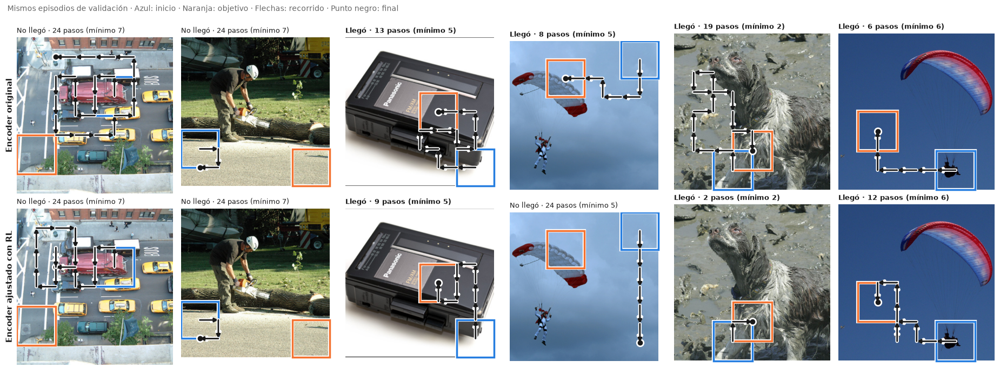

# glimpse-nav-rl

Ajuste fino de un encoder de imágenes (DINOv2 ViT-S/14) usando solo RL. Un agente PPO se mueve sobre una imagen viendo recortes de 112 px (glimpses) hasta llegar a un glimpse objetivo; la pérdida de PPO se propaga a los dos últimos bloques del encoder. El encoder nunca ve la imagen completa durante el ajuste.

- Plan y decisiones de diseño: [ROADMAP.md](ROADMAP.md)
- Registro cronológico de cada paso, comando y resultado: [BITACORA.md](BITACORA.md)

## Conclusión

Se puede ajustar el encoder solo con RL: un agente nuevo navega mejor sobre el encoder ajustado y la pérdida de información general es pequeña. No se encontró que RL sea claramente mejor que una línea base sin RL (regresión del desplazamiento entre dos glimpses).

| Encoder | Éxito en validación | SPL | k-NN Imagenette | k-NN Imagewoof |
|---|---|---|---|---|
| Original | 71,9 ± 1,1 % | 0,470 | 99,54 % | 95,27 % |
| RL, LR 3e-6 | 75,0 ± 0,6 % | 0,517 | 99,39 % | 95,27 % |
| RL, LR 1e-5 | 79,7 ± 0,8 % | 0,565 | 99,29 % | 94,96 % |
| RL, LR 1e-5 (segunda semilla del ajuste) | 79,6 ± 0,4 % | 0,569 | 99,31 % | 94,91 % |
| RL, LR 3e-5 | 80,9 ± 0,2 % | 0,595 | 98,24 % | 91,70 % |
| Regresión, LR 3e-7 | 76,9 ± 0,5 % | 0,530 | 99,31 % | 95,22 % |
| Regresión, LR 1e-6 | 77,7 ± 0,8 % | 0,546 | 99,26 % | 94,78 % |
| Regresión, LR 3e-6 | 79,2 ± 0,5 % | 0,566 | 99,19 % | 93,87 % |
| Regresión, LR 1e-5 | 77,8 ± 0,5 % | 0,565 | 98,88 % | 91,73 % |
| Regresión, LR 3e-5 | 76,1 ± 0,9 % | 0,563 | 98,32 % | 85,57 % |

Éxito: media ± desviación sobre 3 semillas de un agente nuevo entrenado 10 M de pasos con el encoder congelado. k-NN: imagen completa a 224 px, k = 20.

Otros resultados (detalle en la bitácora):

- **Transferencia** a glimpses sin solape (zoom 1,75×): original 57,1 %, RL 1e-5 64,3 %, regresión 3e-6 63,1 %.
- **El agente va al objetivo, no barre la imagen:** con el objetivo de otra imagen el éxito cae de 71,8 % a 28,8 % (caminata al azar: 23,0 %).
- **Sondas espaciales:** mejoras pequeñas en dirección del vecino; la posición absoluta no cambia.
- **Memorización:** la regresión con LR alto sobreajusta (90,5 % en entrenamiento, 76,1 % en validación); RL no.




## Límites

Un solo encoder, un solo dataset de ajuste (Imagenette) y una sola medida de olvido (k-NN de imagen completa). La regresión tiene una sola semilla de ajuste, así que las diferencias de unos 2 puntos entre RL y regresión no están confirmadas.

## Archivos

| Archivo | Qué hace |
|---|---|
| `glimpse.py`, `env.py` | Encoder, rejilla de glimpses y entorno de navegación |
| `ppo.py` | PPO (adaptado de CleanRL); `sb3_check.py` lo contrasta con Stable-Baselines3 |
| `finetune.py` | Ajuste del encoder con RL |
| `regress.py` | Línea base sin RL |
| `eval_repr.py` | Experimento B (k-NN, coseno, CKA) |
| `probes.py` | Sondas espaciales |
| `modal_app.py` | Lanza todo lo anterior en Modal |
| `fig_ab.py`, `fig_antes_despues.py`, `viz.py`, `analysis.py` | Figuras y análisis |
| `results/` | Resultados crudos de cada corrida |

## Reproducir

Los comandos exactos de cada corrida están en la bitácora. Los principales:

```bash
uv sync
uv run modal run --detach modal_app.py::main --runs "ft_k2_lr1e-5:--k 2 --lr-enc 1e-5"   # ajuste con RL
uv run modal run --detach modal_app.py::experiments                                      # experimentos A y B
uv run modal run --detach modal_app.py::run_transfer                                     # sondas y transferencia
uv run python fig_ab.py                                                                  # figura
```

Los pesos de los encoders ajustados no están en el repo: quedan en el Volume de Modal `glimpse-nav-rl`, carpeta `out/` (`<nombre>_encoder.pt`).
