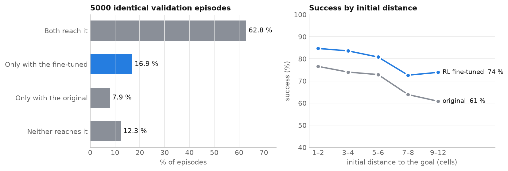

# glimpse-nav-rl

Fine-tuning an image encoder (DINOv2 ViT-S/14) with RL only. A PPO agent moves over an image seeing 112 px crops (glimpses) until it reaches a goal glimpse; the PPO loss is backpropagated into the last two blocks of the encoder. The encoder never sees the full image during fine-tuning.

- Plan and design decisions: [ROADMAP.md](ROADMAP.md)
- Chronological log of every step, command and result: [LOG.md](LOG.md)

## Conclusion

The encoder can be fine-tuned with RL alone: a fresh agent navigates better on the fine-tuned encoder, and the loss of general information is small. We did not find RL to be clearly better than a no-RL baseline (regressing the offset between two glimpses).

| Encoder | Validation success | SPL | k-NN Imagenette | k-NN Imagewoof |
|---|---|---|---|---|
| Original | 71.9 ± 1.1 % | 0.470 | 99.54 % | 95.27 % |
| RL, LR 3e-6 | 75.0 ± 0.6 % | 0.517 | 99.39 % | 95.27 % |
| RL, LR 1e-5 | 79.7 ± 0.8 % | 0.565 | 99.29 % | 94.96 % |
| RL, LR 1e-5 (second fine-tuning seed) | 79.6 ± 0.4 % | 0.569 | 99.31 % | 94.91 % |
| RL, LR 3e-5 | 80.9 ± 0.2 % | 0.595 | 98.24 % | 91.70 % |
| Regression, LR 3e-7 | 76.9 ± 0.5 % | 0.530 | 99.31 % | 95.22 % |
| Regression, LR 1e-6 | 77.7 ± 0.8 % | 0.546 | 99.26 % | 94.78 % |
| Regression, LR 3e-6 | 79.2 ± 0.5 % | 0.566 | 99.19 % | 93.87 % |
| Regression, LR 1e-5 | 77.8 ± 0.5 % | 0.565 | 98.88 % | 91.73 % |
| Regression, LR 3e-5 | 76.1 ± 0.9 % | 0.563 | 98.32 % | 85.57 % |

Success: mean ± standard deviation over 3 seeds of a fresh agent trained for 10 M steps on the frozen encoder. k-NN: full image at 224 px, k = 20.

Other results (details in the log):

- **Transfer** to non-overlapping glimpses (1.75× zoom): original 57.1 %, RL 1e-5 64.3 %, regression 3e-6 63.1 %.
- **The agent goes to the goal, it does not sweep the image:** given another image's goal, success drops from 71.8 % to 28.8 % (random walk: 23.0 %).
- **Spatial probes:** small gains in neighbour direction; absolute position is unchanged.
- **Memorization:** regression at high LR overfits (90.5 % on train, 76.1 % on validation); RL does not.




## Limitations

One encoder, one fine-tuning dataset (Imagenette) and one forgetting measure (full-image k-NN). Regression has a single fine-tuning seed, so the roughly 2-point differences between RL and regression are not confirmed.

## Files

| File | What it does |
|---|---|
| `glimpse.py`, `env.py` | Encoder, glimpse grid and navigation environment |
| `ppo.py` | PPO (adapted from CleanRL); `sb3_check.py` cross-checks it against Stable-Baselines3 |
| `finetune.py` | Encoder fine-tuning with RL |
| `regress.py` | No-RL baseline |
| `eval_repr.py` | Experiment B (k-NN, cosine, CKA) |
| `probes.py` | Spatial probes |
| `modal_app.py` | Launches all of the above on Modal |
| `fig_ab.py`, `fig_before_after.py`, `viz.py`, `analysis.py` | Figures and analysis |
| `results/` | Raw results of every run |

## Reproducing

The exact commands for every run are in the log. The main ones:

```bash
uv sync
uv run modal run --detach modal_app.py::main --runs "ft_k2_lr1e-5:--k 2 --lr-enc 1e-5"   # RL fine-tuning
uv run modal run --detach modal_app.py::experiments                                      # experiments A and B
uv run modal run --detach modal_app.py::run_transfer                                     # probes and transfer
uv run python fig_ab.py                                                                  # figure
```

## Weights

The nine fine-tuned encoders (88 MB each) are attached to the [`weights-v1` release](https://github.com/jackspolski1103/glimpse-nav-rl/releases/tag/weights-v1). `ft_*` are fine-tuned with RL, `reg_*` with the regression baseline; the suffix is the encoder learning rate.

```python
import torch
from glimpse import load_encoder

enc = load_encoder()
enc.load_state_dict(torch.load("ft_k2_lr1e-5_encoder.pt", map_location="cpu"))
```
