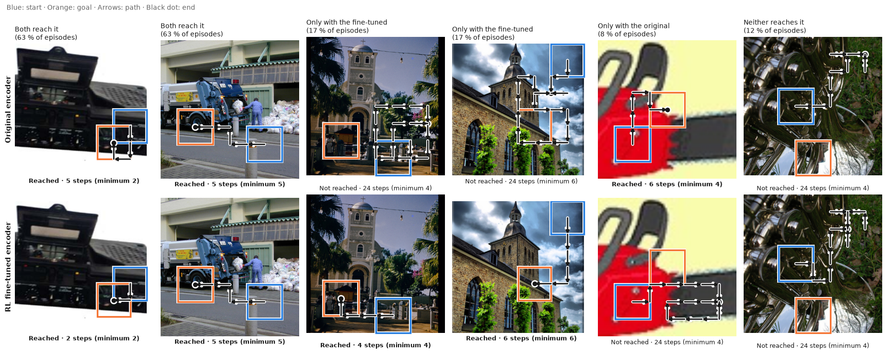
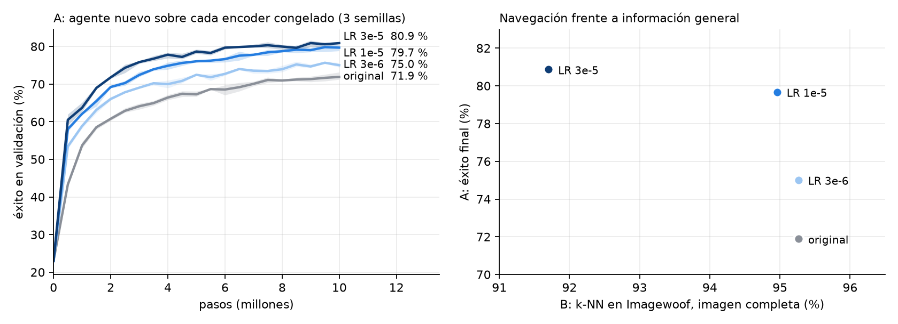

# glimpse-nav-rl

**Can an image encoder be fine-tuned with reinforcement learning alone?**

An agent moves over an image it never sees in full. At each step it gets one small crop (a *glimpse*) and has to reach a goal glimpse. The only training signal is the navigation reward: the PPO loss is backpropagated through the agent into the last blocks of a DINOv2 ViT-S/14. No labels, no reconstruction, no contrastive loss.

**Short answer: yes.** A fresh agent trained on the fine-tuned encoder reaches the goal in 79.7 % of validation episodes, against 71.9 % on the original DINOv2, while full-image k-NN accuracy on Imagewoof moves from 95.27 % to 94.96 %. A simple no-RL baseline gets close to the same trade-off, so we do not claim RL is the better way to get there.



*Same validation episodes with the original encoder (top) and the RL fine-tuned one (bottom). Examples are the first ones found in each category, not hand-picked.*

## How it works

| | |
|---|---|
| Encoder | DINOv2 ViT-S/14 (`timm`, `vit_small_patch14_dinov2.lvd142m`), CLS token, 384 dimensions |
| Image and glimpses | 448×448 px image, 112×112 px glimpses on a 7×7 grid (stride 56). Each glimpse is encoded on its own: the encoder never sees the full image |
| Observation | Embedding of the current glimpse, embedding of the goal glimpse, egocentric map of visited cells, bump signal |
| Actions and reward | Up, down, left, right. +1 on reaching the goal, −0.01 per step, 24 steps at most |
| Agent | PPO adapted from [CleanRL](https://github.com/vwxyzjn/cleanrl), MLP 256-256, 256 parallel environments |
| Data | [Imagenette](https://github.com/fastai/imagenette) for fine-tuning; Imagewoof only for evaluation |

Fine-tuning has two stages:

1. **Frozen encoder, 2 M steps.** Only the agent is trained.
2. **Live encoder, 6 M steps.** The last 2 of the 12 blocks and the final norm are unfrozen (3.55 M of 22 M parameters) and trained together with the agent, by the same PPO loss, at a much lower learning rate than the agent's. The goal embedding keeps coming from the frozen original encoder.

The fine-tuned encoder is then evaluated in two experiments:

- **A, navigation:** freeze the encoder, discard the agent, and train a new agent from scratch for 10 M steps (3 seeds).
- **B, general information:** k-NN classification (k = 20) with the full image at 224 px, the standard DINOv2 evaluation.

## Results

| Encoder | Navigation success (val) | SPL | k-NN Imagenette | k-NN Imagewoof |
|---|---|---|---|---|
| Original DINOv2 | 71.9 ± 1.1 % | 0.470 | 99.54 % | 95.27 % |
| RL, LR 3e-6 | 75.0 ± 0.6 % | 0.517 | 99.39 % | 95.27 % |
| **RL, LR 1e-5** | **79.7 ± 0.8 %** | 0.565 | 99.29 % | 94.96 % |
| RL, LR 1e-5, second fine-tuning seed | 79.6 ± 0.4 % | 0.569 | 99.31 % | 94.91 % |
| RL, LR 3e-5 | 80.9 ± 0.2 % | 0.595 | 98.24 % | 91.70 % |
| Regression, LR 3e-7 | 76.9 ± 0.5 % | 0.530 | 99.31 % | 95.22 % |
| Regression, LR 1e-6 | 77.7 ± 0.8 % | 0.546 | 99.26 % | 94.78 % |
| Regression, LR 3e-6 | 79.2 ± 0.5 % | 0.566 | 99.19 % | 93.87 % |
| Regression, LR 1e-5 | 77.8 ± 0.5 % | 0.565 | 98.88 % | 91.73 % |
| Regression, LR 3e-5 | 76.1 ± 0.9 % | 0.563 | 98.32 % | 85.57 % |

Success is the mean ± standard deviation over 3 agent seeds. *Regression* is the no-RL baseline: the same blocks, learning rates and number of glimpses, but trained to predict the offset between the current and the goal glimpse.



What the experiments show:

- **RL fine-tuning helps navigation and costs little.** At LR 1e-5: +7.8 points of success for −0.3 points of k-NN on Imagewoof. A second, independent fine-tuning lands within 0.1 points.
- **The agent goes to the goal; it does not sweep the image.** Given the goal of a different image, success drops from 71.8 % to 28.8 %, close to a random walk (23.0 %).
- **The gain transfers.** On a layout no encoder was tuned on (non-overlapping glimpses, 1.75× zoom), success goes from 57.1 % to 64.3 %.
- **RL does not clearly beat regression.** The two frontiers cross, and the differences are about 2 points.
- **Regression memorizes at high LR, RL does not.** At LR 3e-5 regression reaches 90.5 % on training images and 76.1 % on validation; RL stays at 82.2 % and 80.9 %.
- **What changed inside the encoder is only partly explained.** Linear probes for the direction of a neighbouring glimpse improve from 46.7 % to 51.5 %; absolute position does not change.


## Limitations

- One encoder (ViT-S/14) and one fine-tuning dataset (Imagenette, about 9,500 images).
- One measure of forgetting (full-image k-NN on two ImageNet subsets). Nothing dense, such as segmentation.
- The regression baseline has a single fine-tuning seed, so the RL versus regression comparison is not settled.

## Setup

```bash
uv sync
mkdir -p data && curl -L https://s3.amazonaws.com/fast-ai-imageclas/imagenette2.tgz | tar -xz -C data
```

The checks run as plain scripts:

```bash
uv run python test_no_leak.py     # each glimpse embedding depends only on its own pixels
uv run python test_finetune.py    # the split encoder matches the full one; gradients reach only the unfrozen blocks
```

## Reproducing

Phases 0 and 1 run on a laptop:

```bash
uv run python precompute.py                                                      # embeddings of every glimpse
uv run python probes.py                                                          # spatial probes on the frozen encoder
uv run python ppo.py --task embeddings --steps 10000000 --evals 20 --name frozen_bump_s0
uv run python viz.py --name frozen_bump_s0                                       # learning curve and paths
```

Fine-tuning needs a GPU. The runs here used an A10 on [Modal](https://modal.com) (about 50 minutes per fine-tuning):

```bash
uv run modal run --detach modal_app.py::main --runs "ft_k2_lr1e-5:--k 2 --lr-enc 1e-5 --s2 6000000 --evals 12"
uv run modal run --detach modal_app.py::main --module regress --runs "reg_k2_lr3e-6:--k 2 --lr-enc 3e-6"
uv run modal run --detach modal_app.py::experiments        # experiments A and B
uv run modal run --detach modal_app.py::run_transfer       # probes and the transfer task
uv run python fig_ab.py && uv run python fig_before_after.py
```

Every run, with its exact command and result, is in [LOG.md](LOG.md). The plan and design decisions are in [ROADMAP.md](ROADMAP.md).

## Weights

The nine fine-tuned encoders (88 MB each) are attached to the [`weights-v1` release](https://github.com/jackspolski1103/glimpse-nav-rl/releases/tag/weights-v1). `ft_*` are fine-tuned with RL and `reg_*` with the regression baseline; the suffix is the encoder learning rate.

```python
import torch
from glimpse import load_encoder

enc = load_encoder()
enc.load_state_dict(torch.load("ft_k2_lr1e-5_encoder.pt", map_location="cpu"))
```

## Repository layout

| File | What it does |
|---|---|
| `glimpse.py`, `env.py` | Encoder, glimpse grid and navigation environment |
| `precompute.py` | Embeddings of all glimpses with the frozen encoder |
| `ppo.py` | PPO; `sb3_check.py` cross-checks it against Stable-Baselines3 |
| `finetune.py` | Encoder fine-tuning with RL |
| `regress.py` | No-RL baseline |
| `eval_repr.py` | Experiment B (k-NN, cosine similarity, CKA) |
| `probes.py` | Spatial probes |
| `modal_app.py` | Launches all of the above on Modal |
| `viz.py`, `analysis.py`, `fig_ab.py`, `fig_before_after.py` | Figures and analysis |
| `results/` | Raw results of every run |

## Acknowledgements

Built on [DINOv2](https://github.com/facebookresearch/dinov2) (Apache 2.0; the released weights are derived from it), the PPO implementation of [CleanRL](https://github.com/vwxyzjn/cleanrl), [timm](https://github.com/huggingface/pytorch-image-models) and the [Imagenette and Imagewoof](https://github.com/fastai/imagenette) datasets.
